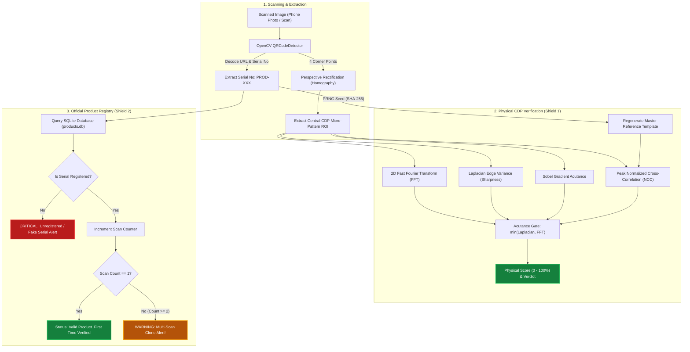

# Anti-Counterfeit QR Code & Product Authentication System
## Complete Technical Specification, Architecture, Testing Protocol & Demo Guide

---

## 1. Executive Summary

This project implements an industrial-grade **Dual-Shield Anti-Counterfeit QR Code Solution** based on **Copy Detection Pattern (CDP)** technology. It solves the critical vulnerability of standard barcodes and ordinary QR codes: **photocopy and reprint cloning**.

Ordinary QR codes can be easily photographed, photocopied, or reprinted by counterfeiters, and standard smartphone cameras will scan the counterfeit label without error. 

Our system solves this by integrating:
1. **Physical Fingerprint Layer (CDP):** A high-entropy, pseudo-random micro-dot pattern embedded in the center cutout of a Level-H QR code, equipped with fiducial alignment marks. The micro-dots exist at the physical resolution limit of commercial printing ($600\text{–}1200\text{ DPI}$). Any attempt to photocopy, photograph, or reprint the code causes irreversible physical degradation (dot gain, optical blurring, Bayer interpolation loss), collapsing high spatial frequencies and triggering an automatic **`COUNTERFEIT (REPRINT / BLUR DETECTED)`** verdict.
2. **Digital Supply Chain Registry Layer (Database & Audit Trail):** Every physical label is cryptographically bound to a unique serial number in an official SQLite product registry. It tracks product details (Name, Brand, Batch Number, Expiry, MRP) and maintains a real-time **Scan Counter** that immediately flags duplicate/reused QR codes (**Clone Attack Alert**).

---

## 2. Tech Stack

| Component | Technology | Role & Responsibility |
| :--- | :--- | :--- |
| **Programming Language** | **Python 3.14+** | Core runtime for barcode generation, mathematical signal processing, and server. |
| **Barcode Generation** | **`qrcode` (Level H)** | Generates high error-correction (30% recovery) QR matrices allowing central cutout. |
| **Image Processing** | **Pillow (`PIL`) & OpenCV (`cv2`)** | Sub-pixel homography, perspective warping, image filtering, and visual cards. |
| **Signal Processing & FFT** | **NumPy & SciPy** | 2D Fast Fourier Transform (FFT) for high-frequency spectral energy, Normalized Cross-Correlation (NCC). |
| **Edge & Acutance Analysis** | **OpenCV Laplacian & Sobel** | Second-order derivative variance measuring micro-edge sharpness. |
| **Database & Audit Logs** | **SQLite3** | Embedded, zero-configuration relational database tracking product lifecycle and scan logs. |
| **Web Studio & UI** | **HTML5, CSS3, JavaScript, Web APIs** | Modern responsive dashboard with 1-Click test suite, live blur slider, drag-and-drop upload, and camera capture. |
| **Backend Server** | **Python `http.server` & REST APIs** | Lightweight HTTP server serving static assets and JSON verification endpoints. |

---

## 3. How It Works (The Science & Mathematics)

### 3.1 Dual-Shield Authentication Workflow



---

### 3.2 The Physical Print-and-Scan (P&S) Channel

When an image is printed and subsequently scanned or photographed, it passes through an analog degradation channel governed by optical modulation transfer functions (MTF) and physical ink spread:

1. **1st-Generation Print (GENUINE ORIGINAL):**
   - Printed at $600\text{–}1200\text{ DPI}$ on industrial packaging lines.
   - Individual micro-dots ($84\ \mu\text{m}$) remain discrete and binary.
   - Spatial frequency spectrum preserves high power in the high-frequency ring ($HF \ge 0.065\text{–}0.085$).
   - Laplacian variance remains high ($\ge 8,500\text{–}15,000$).
   - Normalized Cross-Correlation (NCC) with digital seed template is high ($\ge 0.70\text{–}0.95$).

2. **2nd-Generation Reprint (COUNTERFEIT / PHOTOCOPY ATTACK):**
   - Counterfeiter photographs or scans the genuine label.
   - Optical diffraction, sensor blur, and Bayer interpolation introduce initial low-pass filtering.
   - Counterfeiter prints the file on a consumer or commercial printer.
   - **Secondary dot gain (ink-bleeding):** The ink from adjacent micro-dots bleeds across the white paper fibers, fusing individual dots into blurry gray puddles.
   - When scanned for verification:
     - Laplacian variance collapses by **$80\%\text{–}98\%$** ($< 200$).
     - High-frequency FFT power drops by **$90\%\text{–}98\%$** ($< 0.010$).
     - The **Acutance Gate** detects this catastrophic loss and flags the item as **`COUNTERFEIT (REPRINT / BLUR DETECTED)`**, even if the standard QR code payload decodes.

---

### 3.3 Physical Print Dimensions & 600 DPI Specification (100% Scale Guide)

To ensure microscopic acutance operates reliably on production lines, the master PNG is generated at a native optical density of **600 DPI (Dots Per Inch)**.

| Parameter | 12px Box (Standard Label) | 10px Box (Compact Blister) | 14px Box (Carton Box) |
| :--- | :--- | :--- | :--- |
| **Pixel Dimensions** | **`588 × 588 px`** | `490 × 490 px` | `686 × 686 px` |
| **Native Print DPI** | **`600 DPI`** | `600 DPI` | `600 DPI` |
| **Physical Width** | **$2.489\text{ cm} \approx \mathbf{2.5\text{ cm}}$** | $2.07\text{ cm} \approx 2.1\text{ cm}$ | $2.90\text{ cm} \approx 2.9\text{ cm}$ |
| **Physical Width (Inches)** | **$0.98\text{ in} \approx \mathbf{1.0\text{ in}}$** | $0.82\text{ in}$ | $1.14\text{ in}$ |
| **CDP Micro-dot Width** | **$2\text{ px} = 84.6\ \mu\text{m}$** | $2\text{ px} = 84.6\ \mu\text{m}$ | $2\text{ px} = 84.6\ \mu\text{m}$ |
| **Intended Physical Target** | Pharmaceutical vials, box seals | Small ampoules & blister packs | Outer shipper carton boxes |

#### Formula for 100% Actual Print Size:
$$\text{Physical Size (cm)} = \left(\frac{\text{Pixel Width}}{\text{DPI}}\right) \times 2.54 = \left(\frac{588}{600}\right) \times 2.54 = \mathbf{2.489\text{ cm} \ (\approx 2.5 \times 2.5\text{ cm})}$$

#### Why did Windows File Properties show 96 DPI initially?
- By default, standard web images lack physical print metadata (PNG `pHYs` chunk). When a PNG lacks this header, Windows OS falls back to standard monitor resolution (**96 DPI**), causing Windows Properties to show $96\text{ DPI}$.
- If printed at 96 DPI, the code would mistakenly print at $15.56\text{ cm}$ ($6.1\text{ inches}$).
- In our updated pipeline, the master export injects the official **`pHYs` 600 DPI chunk** (`dpi=(600, 600)`). Now, Windows File Properties directly reads **`Horizontal resolution: 600 dpi, Vertical resolution: 600 dpi`**, and industrial printing software automatically outputs the exact **$2.5 \times 2.5\text{ cm}$** packaging size at 100% scale!

---

## 4. Key Verification Metrics & Thresholds

| Metric | Scientific Principle | Genuine 1st-Gen Print | Counterfeit Reprint / Blur | Decision Threshold |
| :--- | :--- | :--- | :--- | :--- |
| **Peak NCC** | Sub-pixel Normalized Cross-Correlation against seed template | `0.72 - 0.95` | `0.38 - 0.42` | $\ge 0.65$ |
| **Laplacian Variance** | 2nd-order spatial derivative measuring micro-edge sharpness | `8,500 - 35,000+` | `100 - 1,500` *(Massive drop)* | $\ge 8,500$ |
| **FFT High-Freq Ratio** | 2D Fourier energy outside low-frequency radius ($r > 0.20$) | `0.065 - 0.290` | `0.001 - 0.030` *(Collapsed)* | $\ge 0.060$ |
| **Gradient (Sobel)** | 1st-order edge magnitude across micro-dot transitions | `380 - 650+` | `80 - 230` | $\ge 370$ |
| **Acutance Gate** | $\min(\text{Laplacian Norm}, \text{FFT Norm})$ bottleneck factor | `1.0 (Full Pass)` | `0.00 - 0.40 (Blocked)` | $\ge 0.75$ |
| **Authenticity Score** | Calibrated multi-factor confidence index | **`95.0% - 100.0%`** | **`0.0% - 30.0%`** | $\ge 75\%$ |

---

## 5. Live Demonstration & Testing Guide

### 5.1 Quick Launch
Run the interactive Web Studio:
```powershell
cd C:\Users\91761\.gemini\antigravity\scratch\anti_counterfeit_qr
python web_app.py 8080
```
Open **`http://localhost:8080`** in Google Chrome or Microsoft Edge.

---

### 5.2 Demo Scenario 1: Creating a Fresh Product & Testing 1st-Gen Genuine Scan
1. On the **Left Card (Register Product & Generate QR)**:
   - Click **`[ 🎲 New Unique Serial ]`** to assign a fresh serial (e.g. `PROD-542`).
   - Notice that the **QR Payload URL automatically updates** with `?id=PROD-542`.
   - Enter Product Name (e.g. `Paracetamol 500mg IP`), Brand, Batch No (`BATCH-26`), Expiry Date, MRP.
   - Click **"Register Product & Generate QR"**.
2. On the **Right Card (Product & Physical Authenticity Check)**:
   - Click **"1. Genuine Scan"**.
   - **Expected Result:**
     - **Physical Verdict:** `GENUINE (ORIGINAL PRINT)`
     - **Confidence Score:** `100.0%`
     - **Official Product Record:** Shows Product Name, Brand, Batch No.
     - **Scan Counter:** `1`
     - **Alert Banner (Green):** `Valid Product. First time verified.`

---

### 5.3 Demo Scenario 2: Testing Multi-Scan Duplicate / Clone Alert
1. Keep the same product active and click **"1. Genuine Scan"** again (simulating a second person scanning the same label or a counterfeiter reusing the QR code).
2. **Expected Result:**
   - **Physical Verdict:** `GENUINE (ORIGINAL PRINT)`
   - **Scan Counter:** Updates to `2` (or `3`).
   - **Alert Banner (Yellow Warning):** `WARNING: This QR code has already been scanned 2 times! Possible clone or reused packaging!`

---

### 5.4 Demo Scenario 3: Testing User's Blur Attack
1. Click **"2. Blur Attack"** (or switch to the **"Custom Blur Slider"** tab, adjust $\sigma = 0.8\text{–}1.2$, and click "Apply & Test").
2. **Expected Result:**
   - **Physical Verdict:** `COUNTERFEIT (REPRINT / BLUR DETECTED)`
   - **Confidence Score:** Drops to **`7.0% - 32.0%`**.
   - **Degradation Heatmap:** Displays intense red/yellow error regions where micro-dots were softened.

---

### 5.5 Demo Scenario 4: Testing 2nd-Gen Reprint / Photocopy Attack
1. Click **"3. Reprint Attack"**.
2. **Expected Result:**
   - **Physical Verdict:** `COUNTERFEIT (REPRINT / BLUR DETECTED)`
   - **Confidence Score:** Drops to **`0.0%`**.
   - **Laplacian:** Collapses to `< 150`.
   - **FFT High-Freq:** Collapses to `< 0.002`.

---

### 5.6 Demo Scenario 5: Resetting Scan Counter for a Fresh Demo
- On the Result Card, right next to "Total Scan Count", click **`[ 🔄 Reset to 0 ]`**.
- The count resets to 0 immediately, allowing you to demonstrate the 1st-time scan activation again.

---

## 6. Physical Real-World Lab Testing Protocol

When conducting physical tests with actual paper, printers, and smartphone cameras:

```
[Phase 1] Generate 600 DPI PNG  ──▶  [Phase 2] Print 100% Actual Size
                                              │
                      ┌───────────────────────┴───────────────────────┐
                      ▼                                               ▼
         [Phase 3A] Original Label                       [Phase 3B] Counterfeit Attack
        (Macro Smartphone Photo)                        (Photocopy / Re-print Photo)
                      │                                               │
                      ▼                                               ▼
             Upload to Verifier                              Upload to Verifier
                      │                                               │
                      ▼                                               ▼
             ✅ GENUINE (100%)                              ❌ COUNTERFEIT (0%)
```

### Physical Printing Rules:
1. **Actual Size (100% Scale):** In the printer dialog (`Ctrl+P`), always select **"Actual Size"** or **"100%"**. Never select "Fit to Page" (rescaling distorts dot pitch).
2. **Resolution:** Recommended $600\text{ DPI}$ minimum (standard office laser printer or commercial digital press).
3. **Paper:** Standard white paper, adhesive label stock, or packaging cartons.

### Smartphone Camera Photography Rules:
1. **Distance:** $12\text{–}18\text{ cm}$ macro distance so the QR code fills $\approx 70\%$ of the screen.
2. **Lighting:** Even daylight or diffused office light. Keep phone flashlight **OFF** to avoid hotspot reflections.
3. **Angle:** Direct $90^\circ$ perpendicular overhead view.
4. **Focus:** Tap the center of the QR code on your phone screen to lock optical autofocus.

---

## 7. Project File Structure

All code is situated in [`C:\Users\91761\.gemini\antigravity\scratch\anti_counterfeit_qr`](file:///C:/Users/91761/.gemini/antigravity/scratch/anti_counterfeit_qr):

| File | Description |
| :--- | :--- |
| [`cdp_engine.py`](file:///C:/Users/91761/.gemini/antigravity/scratch/anti_counterfeit_qr/cdp_engine.py) | Generates deterministic pseudo-random micro-patterns, boundary fiducials, and composite 600 DPI QR codes. |
| [`cdp_verifier.py`](file:///C:/Users/91761/.gemini/antigravity/scratch/anti_counterfeit_qr/cdp_verifier.py) | QR decoder, sub-pixel homography, 2D-FFT spectral analysis, Laplacian acutance gating, and comparison heatmap generator. |
| [`product_db.py`](file:///C:/Users/91761/.gemini/antigravity/scratch/anti_counterfeit_qr/product_db.py) | SQLite database layer managing product metadata, audit trail, and clone detection. |
| [`simulator.py`](file:///C:/Users/91761/.gemini/antigravity/scratch/anti_counterfeit_qr/simulator.py) | Print-and-scan physical channel simulator for genuine camera scans and reprint attacks. |
| [`web_app.py`](file:///C:/Users/91761/.gemini/antigravity/scratch/anti_counterfeit_qr/web_app.py) | Full-stack interactive web application serving UI and REST APIs on port 8080. |
| [`cli.py`](file:///C:/Users/91761/.gemini/antigravity/scratch/anti_counterfeit_qr/cli.py) | Command-line utility for batch generation and terminal verification. |
| [`demo_pipeline.py`](file:///C:/Users/91761/.gemini/antigravity/scratch/anti_counterfeit_qr/demo_pipeline.py) | Standalone automated end-to-end verification script. |
| [`products.db`](file:///C:/Users/91761/.gemini/antigravity/scratch/anti_counterfeit_qr/products.db) | SQLite database file storing registered products and audit logs. |
