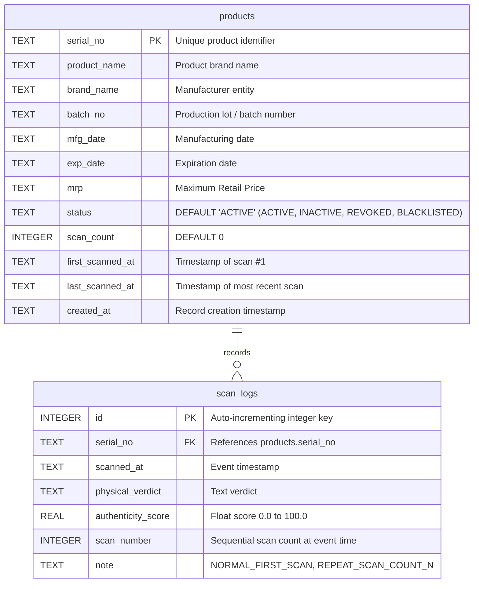

# Anti-Counterfeit QR Code Authentication System: API & Database Reference

> **Document Version:** 2.0.0  
> **Status:** Production Reference  
> **Module Path:** `C:\Users\91761\.gemini\antigravity\scratch\anti_counterfeit_qr\docs`  

---

## 1. REST API Endpoint Specification

All endpoints are hosted on the embedded HTTP server running on port `8080` (or the port passed as a CLI argument to `python web_app.py <PORT>`).

### 1.1 Summary Matrix

| Method | Route | Category | Request Format | Response Format | Purpose |
| :--- | :--- | :--- | :--- | :--- | :--- |
| `GET` | `/` | Web UI | None | `text/html` | Serves the interactive Web Studio interface |
| `GET` | `/api/products` | Database | None | `application/json` | Fetches the list of recent registered products |
| `GET` | `/api/download` | Export | Query Param: `?serial=...` | `image/png` | Downloads 600 DPI master print-ready PNG |
| `POST` | `/api/generate` | Generation | `application/json` | `application/json` | Creates & registers new Anti-Counterfeit QR Code |
| `POST` | `/api/verify` | Verification | `application/json` | `application/json` | Ingests camera image and performs verification |
| `POST` | `/api/simulate` | Testing | `application/json` | `application/json` | Runs simulated channel attack (blur/reprint/photocopy) |
| `POST` | `/api/reset-scans`| Management | `application/json` | `application/json` | Resets product scan counter to 0 |

---

### 1.2 Endpoint Details & Contracts

#### 1. `POST /api/generate`
Generates a new anti-counterfeit QR code with an embedded Copy Detection Pattern (CDP) and stores the product metadata in the SQLite registry.

- **Headers:**
  ```http
  Content-Type: application/json
  ```
- **Request Body Parameters:**
  | Field | Type | Required | Default | Description |
  | :--- | :--- | :--- | :--- | :--- |
  | `serial_no` | `string` | Optional | `"PROD-2026-X8879"` | Unique serial / cryptographic PRNG seed |
  | `payload` | `string` | Optional | Auto-generated URL | Text or URL encoded in the barcode |
  | `product_name`| `string` | Optional | `"UltraShield Antiviral 500mg"` | Commercial product name |
  | `brand_name` | `string` | Optional | `"Apex Pharma Labs"` | Brand or manufacturer name |
  | `batch_no` | `string` | Optional | `"BATCH-09"` | Production batch identifier |
  | `exp_date` | `string` | Optional | `"2029-01-14"` | Expiry date string |
  | `mrp` | `string` | Optional | `"Rs. 450.00"` | Maximum Retail Price string |
  | `box_size` | `integer`| Optional | `12` | Pixel dimension per QR module |
  | `cdp_ratio` | `float` | Optional | `0.32` | Fraction of QR code width occupied by CDP |

- **Example Request:**
  ```json
  {
    "serial_no": "PROD-2026-X9001",
    "payload": "https://brand-auth.com/verify?id=PROD-2026-X9001&batch=B01",
    "product_name": "OmniCillin 250mg Antibiotic",
    "brand_name": "Aura Pharma Global",
    "batch_no": "B01",
    "exp_date": "2029-03-01",
    "mrp": "Rs. 380.00",
    "box_size": 12,
    "cdp_ratio": 0.32
  }
  ```

- **Example Response (`HTTP 200 OK`):**
  ```json
  {
    "status": "SUCCESS",
    "qr_image": "data:image/png;base64,iVBORw0KGgoAAAANSUhEUgAAA...",
    "cdp_image": "data:image/png;base64,iVBORw0KGgoAAAANSUhEUgAA...",
    "width": 636,
    "height": 636
  }
  ```

---

#### 2. `POST /api/verify`
The primary authentication endpoint. Ingests a camera photograph (as a Base64 string), runs multi-pass decoding, canonical perspective rectification, micro-dot morphology analysis, and returns the classification verdict.

- **Headers:**
  ```http
  Content-Type: application/json
  ```
- **Request Body Parameters:**
  | Field | Type | Required | Description |
  | :--- | :--- | :--- | :--- |
  | `image_b64` | `string` | Required | Base64-encoded image (`data:image/jpeg;base64,...` or raw Base64) |
  | `expected_serial`| `string` | Optional | Optional hint for serial comparison |

- **Example Request:**
  ```json
  {
    "image_b64": "data:image/jpeg;base64,/9j/4AAQSkZJRgABAQEAYABgAAD/2wBDAAgGBgcGBQgHBwcJCQgKDBQNDAsLDBkSEw8UHRofHh0aHBwgJC4nICIsIxwcKDcpLDAxNDQ0Hyc5PTgyPC4zNDL/..."
  }
  ```

- **Example Response (`HTTP 200 OK`):**
  ```json
  {
    "status": "GENUINE",
    "verdict": "GENUINE (ORIGINAL PRINT)",
    "is_genuine": true,
    "authenticity_score": 94.9,
    "qr_payload": "https://brand-auth.com/verify?id=PROD-2026-X9001&batch=B01",
    "serial_number": "PROD-2026-X9001",
    "product_info": {
      "serial_no": "PROD-2026-X9001",
      "product_name": "OmniCillin 250mg Antibiotic",
      "brand_name": "Aura Pharma Global",
      "batch_no": "B01",
      "mfg_date": "2026-03-01",
      "exp_date": "2029-03-01",
      "mrp": "Rs. 380.00",
      "scan_count": 1,
      "first_scanned_at": "2026-10-19 13:15:20",
      "last_scanned_at": "2026-10-19 13:15:20",
      "is_registered": true,
      "db_status": "REGISTERED & VERIFIED",
      "clone_alert": false,
      "clone_message": "Valid Product. First time verified."
    },
    "metrics": {
      "peak_cross_correlation_ncc": 0.6082,
      "peak_ncc": 0.6082,
      "laplacian_edge_variance": 847.3,
      "edge_acutance_laplacian": 847.3,
      "fft_high_freq_ratio": 0.00403,
      "gradient_sharpness": 179.4,
      "dot_morphology_pa_ratio": 0.377,
      "dot_morphology_density": 0.501,
      "dot_morphology_mean_area": 272.6,
      "dot_morphology_clump_ratio": 0.949,
      "dot_count": 36,
      "micro_void_count": 30,
      "morph_norm": 1.0,
      "is_photocopy_detected": false,
      "ncc_norm": 0.861,
      "lap_norm": 0.836,
      "hf_norm": 1.0,
      "grad_norm": 0.842,
      "sharpness_gate": 0.852,
      "composite_raw": 0.892,
      "full_image_sharpness": 284.1
    },
    "description": "Genuine 1st-generation original print verified. Micro-dot pattern, morphology, and edge sharpness match official cryptographic reference.",
    "comparison_card_b64": "data:image/jpeg;base64,/9j/4AAQSkZJRg..."
  }
  ```

---

#### 3. `POST /api/simulate`
Generates a master QR code on-the-fly, passes it through a chosen physical degradation model, and runs verification.

- **Request Body Parameters:**
  | Field | Type | Description |
  | :--- | :--- | :--- |
  | `type` | `string` | `"genuine"`, `"blur_test"`, `"custom_blur"`, `"counterfeit"`, or `"photocopy"` |
  | `serial_no` | `string` | Serial identifier to simulate |
  | `payload` | `string` | Encoded URL/text |
  | `sigma` | `float` | Gaussian blur sigma (when `type == "custom_blur"`, e.g. `0.8`) |

- **Example Request (Photocopy Attack):**
  ```json
  {
    "type": "photocopy",
    "serial_no": "PROD-2026-X8879",
    "payload": "https://brand-auth.com/verify?id=PROD-2026-X8879"
  }
  ```

---

#### 4. `GET /api/products`
Retrieves registered products and their live scan counters.
- **Example Response:**
  ```json
  [
    {
      "serial_no": "PROD-2026-X8879",
      "product_name": "UltraShield Antiviral 500mg",
      "brand_name": "Apex Pharma Labs",
      "batch_no": "BATCH-09",
      "mfg_date": "2026-01-15",
      "exp_date": "2029-01-14",
      "mrp": "Rs. 450.00",
      "status": "ACTIVE",
      "scan_count": 3,
      "first_scanned_at": "2026-10-16 17:51:43",
      "last_scanned_at": "2026-10-19 13:24:44",
      "created_at": "2026-10-16 17:49:00"
    }
  ]
  ```

---

## 2. Database Architecture & Schema Specification

The database is implemented using SQLite (`products.db`). Foreign keys and row factories are enabled.



### 2.1 Table: `products`
Stores registered product definitions, batch parameters, and cumulative verification counters.

| Column | Data Type | Constraints | Description |
| :--- | :--- | :--- | :--- |
| `serial_no` | `TEXT` | `PRIMARY KEY` | Cryptographic PRNG seed and product identifier |
| `product_name` | `TEXT` | `NOT NULL` | Full commercial name of the item |
| `brand_name` | `TEXT` | `NOT NULL` | Manufacturer or brand owner |
| `batch_no` | `TEXT` | `NOT NULL` | Manufacturing batch identifier |
| `mfg_date` | `TEXT` | Nullable | Manufacturing date (`YYYY-MM-DD`) |
| `exp_date` | `TEXT` | Nullable | Expiry date (`YYYY-MM-DD`) |
| `mrp` | `TEXT` | Nullable | Price string (e.g. `"Rs. 450.00"`) |
| `status` | `TEXT` | `DEFAULT 'ACTIVE'` | Status flag (`'ACTIVE'`, `'INACTIVE'`, `'REVOKED'`, `'BLACKLISTED'`) |
| `scan_count` | `INTEGER` | `DEFAULT 0` | Total number of times this serial has been verified |
| `first_scanned_at` | `TEXT` | Nullable | Timestamp when first verified (`YYYY-MM-DD HH:MM:SS`) |
| `last_scanned_at` | `TEXT` | Nullable | Timestamp of most recent verification |
| `created_at` | `TEXT` | `NOT NULL` | Timestamp when registered |

---

### 2.2 Table: `scan_logs`
Maintains an immutable audit log of every scan attempt for forensic analysis and clone detection.

| Column | Data Type | Constraints | Description |
| :--- | :--- | :--- | :--- |
| `id` | `INTEGER` | `PRIMARY KEY AUTOINCREMENT`| Unique audit log record ID |
| `serial_no` | `TEXT` | Foreign Key (implicit) | Serial number of scanned label |
| `scanned_at` | `TEXT` | `NOT NULL` | Exact timestamp of verification event |
| `physical_verdict`| `TEXT` | Nullable | Full classification string (e.g. `GENUINE (ORIGINAL PRINT)`) |
| `authenticity_score`| `REAL` | Nullable | Numerical score `0.0` to `100.0` |
| `scan_number` | `INTEGER` | Nullable | Sequential scan count at that specific moment |
| `note` | `TEXT` | Nullable | Security flag (`NORMAL_FIRST_SCAN`, `REPEAT_SCAN_COUNT_N`, `UNREGISTERED_SERIAL`) |

---

### 2.3 SQL Statements & Queries Used in Codebase

#### Database Initialization (`product_db.py` line 24):
```sql
CREATE TABLE IF NOT EXISTS products (
    serial_no TEXT PRIMARY KEY,
    product_name TEXT NOT NULL,
    brand_name TEXT NOT NULL,
    batch_no TEXT NOT NULL,
    mfg_date TEXT,
    exp_date TEXT,
    mrp TEXT,
    status TEXT DEFAULT 'ACTIVE',
    scan_count INTEGER DEFAULT 0,
    first_scanned_at TEXT,
    last_scanned_at TEXT,
    created_at TEXT NOT NULL
);

CREATE TABLE IF NOT EXISTS scan_logs (
    id INTEGER PRIMARY KEY AUTOINCREMENT,
    serial_no TEXT,
    scanned_at TEXT NOT NULL,
    physical_verdict TEXT,
    authenticity_score REAL,
    scan_number INTEGER,
    note TEXT
);
```

#### Atomic Product Upsert (`product_db.py` line 83):
```sql
INSERT INTO products (serial_no, product_name, brand_name, batch_no, mfg_date, exp_date, mrp, status, created_at)
VALUES (?, ?, ?, ?, ?, ?, ?, 'ACTIVE', ?)
ON CONFLICT(serial_no) DO UPDATE SET
    product_name=excluded.product_name,
    brand_name=excluded.brand_name,
    batch_no=excluded.batch_no,
    mfg_date=excluded.mfg_date,
    exp_date=excluded.exp_date,
    mrp=excluded.mrp;
```

#### Atomic Scan Counter Increment & Audit Logging (`product_db.py` lines 151, 159):
```sql
UPDATE products 
SET scan_count = ?, first_scanned_at = ?, last_scanned_at = ?
WHERE serial_no = ?;

INSERT INTO scan_logs (serial_no, scanned_at, physical_verdict, authenticity_score, scan_number, note)
VALUES (?, ?, ?, ?, ?, ?);
```
