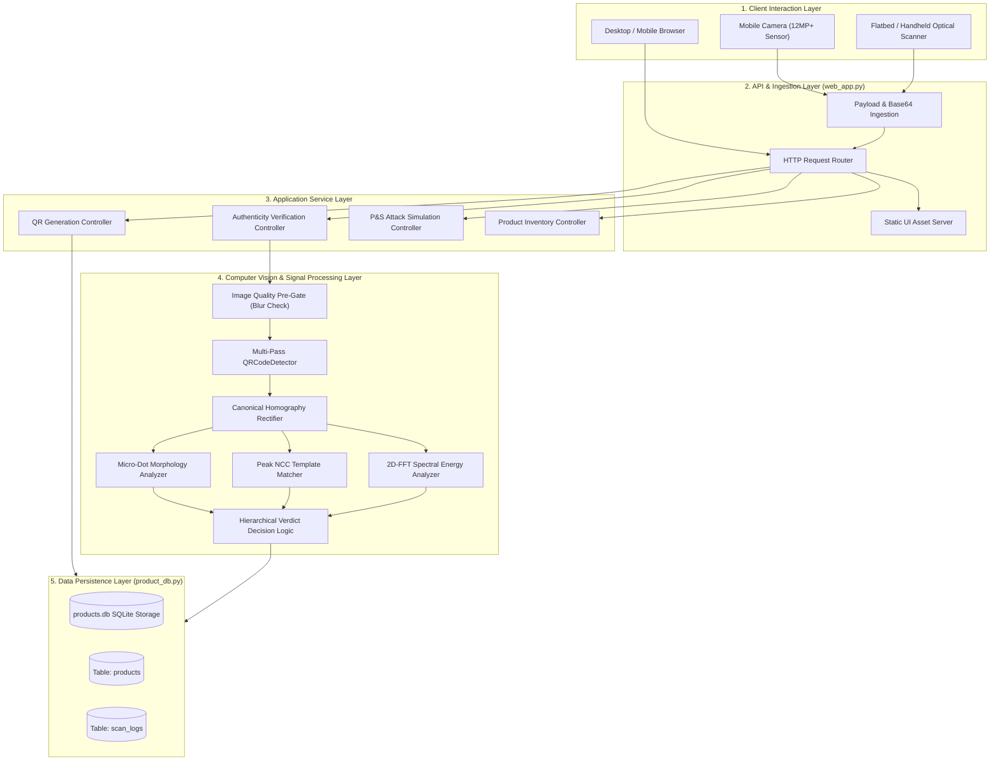
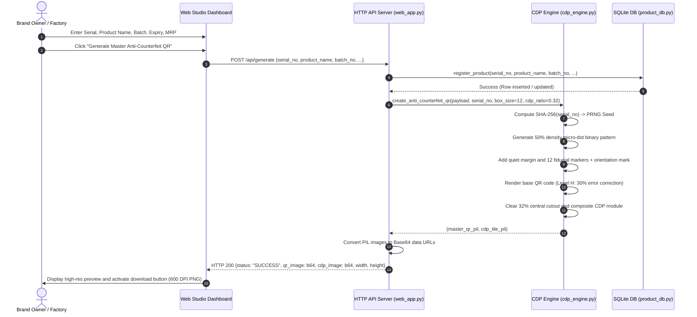
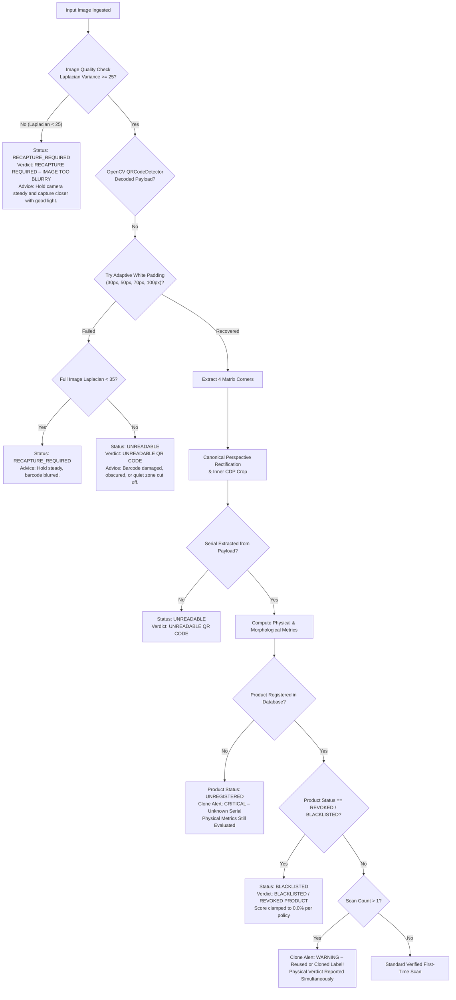
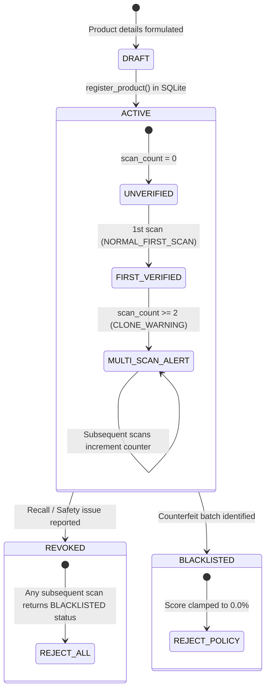

# Anti-Counterfeit QR Code Authentication System: Workflows & Architecture Specification

> **Document Version:** 2.0.0  
> **Status:** Production Reference  
> **Module Path:** `C:\Users\91761\.gemini\antigravity\scratch\anti_counterfeit_qr\docs`  

---

## 1. Architectural Overview

The system follows a modular pipeline architecture designed to execute high-throughput physical authenticity verification of 2D barcodes. It separates the cryptographic data plane (QR payload encoding and deterministic PRNG pattern synthesis) from the physical verification plane (computer vision, geometric homography rectification, and micro-dot morphology analysis).



---

## 2. End-to-End Sequence Workflows

### 2.1 Workflow 1: QR Code Generation & Product Registration
This workflow represents how a brand owner or manufacturer registers a new batch and generates print-ready anti-counterfeit QR codes.



---

### 2.2 Workflow 2: Consumer / Field Verification Workflow
This workflow illustrates what happens when an uploaded camera image is inspected by the system.

```mermaid
sequenceDiagram
    autonumber
    actor Inspector as Consumer / Field Inspector
    participant UI as Camera Viewfinder / Upload
    participant API as HTTP API (web_app.py)
    participant Verifier as CDP Verifier (cdp_verifier.py)
    participant CV as OpenCV Pipeline
    participant DB as SQLite DB (product_db.py)

    Inspector->>UI: Snap photograph or upload photo of physical label
    UI->>API: POST /api/verify {image_b64: "data:image/jpeg;base64,..."}
    
    API->>Verifier: verify_anti_counterfeit_qr(image_input)
    
    %% Step 1: Pre-Gate
    Verifier->>CV: cv2.Laplacian(full_image).var()
    alt Global Laplacian < 25.0 (Severely Blurred)
        Verifier-->>API: {status: "RECAPTURE_REQUIRED", verdict: "IMAGE TOO BLURRY"}
        API-->>UI: Display Orange Recapture Prompt
    else Image is Sharp Enough
        %% Step 2: Decode & Rectify
        Verifier->>CV: QRCodeDetector.detectAndDecode(image)
        alt Barcode Undecodable (Damaged / Obstructed)
            Verifier-->>API: {status: "UNREADABLE", verdict: "UNREADABLE QR CODE"}
            API-->>UI: Display Red Unreadable Error
        else Barcode Decoded Successfully
            Verifier->>Verifier: Extract serial_no from QR payload
            Verifier->>CV: cv2.getPerspectiveTransform(corners, canonical_dst)
            Verifier->>CV: cv2.warpPerspective() -> 636x636 Canonical Image
            
            %% Step 3: CDP Extraction & Reference Generation
            Verifier->>Verifier: Extract inner CDP ROI (center 32%, minus 16% border)
            Verifier->>Verifier: Regenerate digital reference CDP using SHA-256(serial_no)
            
            %% Step 4: Metric Extraction
            Verifier->>CV: cv2.matchTemplate() -> Peak NCC
            Verifier->>CV: cv2.Laplacian().var() -> Edge Acutance
            Verifier->>CV: np.fft.fft2() -> High-Frequency Energy Ratio
            Verifier->>CV: compute_dot_morphology() -> PA-Ratio, Toner Density, Clump Count
            
            %% Step 5: Hierarchical Decision
            Verifier->>Verifier: Evaluate is_photocopy Gate (PA-Ratio < 0.16 or Toner > 65%)
            Verifier->>Verifier: Compute Composite Authenticity Score (0 - 100%)
            
            %% Step 6: Database Scan Logging
            Verifier->>DB: record_scan(serial_no, verdict, score)
            DB->>DB: Increment scan_count, check if scan_count > 1 (Clone Alert)
            DB-->>Verifier: Updated Product Record & Clone Assessment
            
            Verifier-->>API: Full Verification Response (Score, Verdict, Metrics, Product Info)
            API-->>UI: Render Verdict Badge, Confidence Score, Product Card, and Heatmap
            UI->>Inspector: Display Physical Authenticity Report
        end
    end
```

---

### 2.3 Workflow 3: Failure & Recapture Exception Handling
This diagram details the defensive branch logic when encountering degraded, tilted, or damaged physical samples.



---

## 3. Component Interaction & Interface Contracts

### 3.1 `cdp_engine` $\to$ `cdp_verifier` Interface
- **Shared Constant:** Canonical module size `box_size = 12` pixels per QR module.
- **Shared Coordinate Grid:** 
  $$\text{Full Canvas Size} = (modules + 2 \times border) \times canonical\_box = (45 + 8) \times 12 = 636\text{ px}$$
- **Shared PRNG Determinism:** `SHA-256(seed_str) -> int.from_bytes(digest[:4], 'big') -> numpy.random.default_rng(seed)`.
- **Invariance Guarantee:** Whether a candidate image is captured at 4K resolution, 1080p, or an angle, `cdp_verifier` re-projects the detected data matrix corners back onto the canonical $636 \times 636$ coordinate space, ensuring that the candidate micro-dots map 1:1 against the regenerated master template.

### 3.2 `cdp_verifier` $\to$ `product_db` Interface
- When verification concludes, `cdp_verifier` executes:
  ```python
  product_record = product_db.record_scan(serial_no, verdict, authenticity_score)
  ```
- **Database Return Contract:**
  - `is_registered` (`bool`): `True` if serial exists in brand registry.
  - `scan_count` (`int`): Updated scan counter ($1, 2, 3, \dots$).
  - `clone_alert` (`bool`): `True` if `scan_count > 1` or `is_registered == False`.
  - `clone_message` (`str`): Human-readable security alert string.
  - `status` (`str`): Product lifecycle state (`'ACTIVE'`, `'REVOKED'`, `'BLACKLISTED'`).

---

## 4. State Machine: Product & Verification Lifecycle


