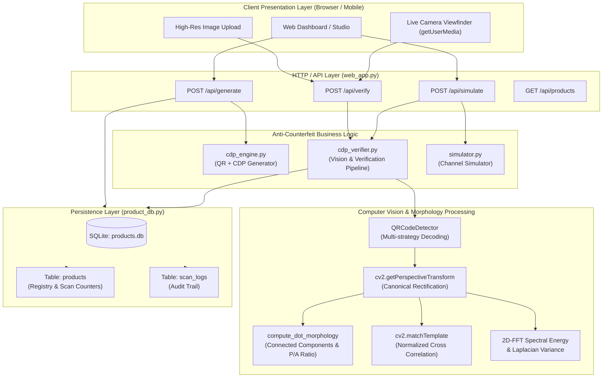
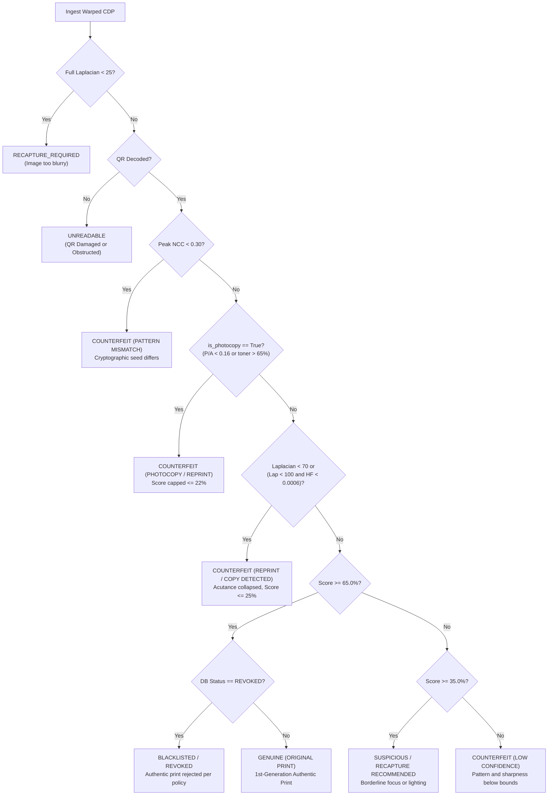
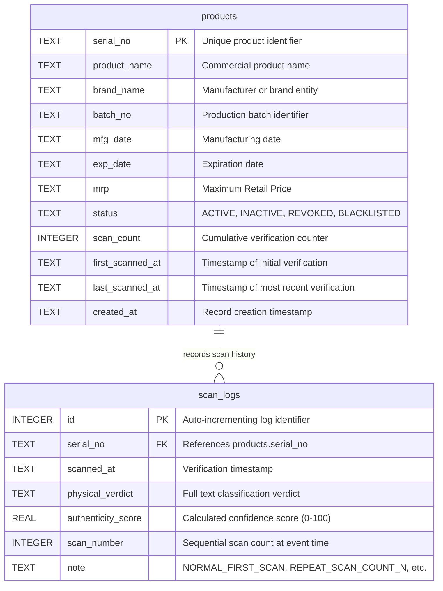

# Anti-Counterfeit QR Code Authentication System: Complete Technical Documentation

> **Document Version:** 2.0.0  
> **Target Audience:** Senior Software Engineers, Solutions Architects, Computer Vision Developers, Quality Assurance Engineers  
> **Status:** Production-Calibrated Reference Implementation  
> **Codebase Path:** `C:\Users\91761\.gemini\antigravity\scratch\anti_counterfeit_qr`  

---

## 1. Executive Summary & Problem Statement

### 1.1 The Core Problem
Standard 2D barcodes (such as standard QR Codes, Data Matrix, or PDF417) are fundamentally **digital data carriers, not security devices**. They are designed with high-contrast, macroscopic geometric modules (black and white squares) and Reed-Solomon forward error correction (FEC) capable of recovering data even if 7% to 30% of the symbol is obscured or damaged.

Because standard QR codes prioritize decodability over physical origin verification:
1. Anyone with a smartphone camera, scanner, or office photocopier can capture a legitimate product QR code.
2. A counterfeiter can reprint that image onto unauthorized packaging or duplicate labels.
3. When scanned with any standard barcode reader or smartphone, the reprinted QR code decodes the exact same payload URL or serial number with **100% success**.
4. The consumer or field inspector is falsely reassured that the product is genuine.

### 1.2 The Solution: Copy Detection Patterns (CDP)
This project solves the physical reproduction problem by integrating a **Copy Detection Pattern (CDP)** into the center of a standard, scannable QR Code (using QR Error Correction Level H). 

A CDP is a high-entropy, pseudo-random digital matrix of micro-dots (at 1–2 pixels per dot at native print resolution). Unlike the macroscopic modules of a QR code, micro-dots are designed to be printed near the physical resolution limits of industrial printing engines (typically 600 to 1200 DPI). 

When a genuine printed label is photocopied or photographed and reprinted by a counterfeiter, it traverses an analog **Print-and-Scan (P&S) Channel degradation**:
- **Optical Modulation Transfer Function (MTF) loss:** The counterfeiter's optical sensor blurs fine spatial frequencies.
- **Bayer demosaicing and compression artifacts:** Sub-pixel color interpolation destroys micro-dot boundaries.
- **Secondary ink spread (Dot Gain) & Toner Bleed:** The secondary printing process deposits ink or toner onto paper fibers that already experienced dot spreading, causing adjacent micro-dots to fuse into solid amorphous blobs.
- **Copier Non-linear Binarization / Sharpening:** Office photocopiers apply unsharp masking and high-contrast thresholding to keep text legible, which irreversibly destroys micro-dot perimeters and obliterates microscopic paper voids.

The verification engine developed in this project does **not** simply read the text payload. It executes a multi-stage computer vision pipeline that isolates the micro-dot pattern, extracts sub-pixel features, evaluates **micro-dot morphology** (perimeter-to-area ratios, toner density, component clumping), tests edge acutance and Fourier spectral roll-off, and cross-correlates the pattern against an on-the-fly cryptographically regenerated digital reference.

---

## 2. Technology Stack & Dependencies

The system is implemented in Python, leveraging scientific computing, computer vision, cryptography, and relational database libraries.

| Technology / Library | Version | Purpose in Project | Why Selected | Where Used | Alternatives Evaluated | Implementation Status |
| :--- | :--- | :--- | :--- | :--- | :--- | :--- |
| **Python** | `3.14.0` (64-bit AMD64) | Runtime environment & core execution engine | Ubiquitous support for scientific computing, image processing, and rapid prototyping | Entire codebase | C++ (higher performance, slower iteration), Go, Java | **Implemented** |
| **OpenCV (`opencv-python`)** | `5.0.0.93` | Computer vision, perspective transform, filtering, connected components | Industry standard; highly optimized C++ backend for geometric transforms, morphology, and template matching | `cdp_verifier.py`, `simulator.py`, `test_master_suite.py` | PIL/Pillow alone (lacks advanced CV algorithms like homography and connected components) | **Implemented** |
| **NumPy** | `2.5.3` | N-dimensional matrix operations, Fast Fourier Transform (FFT), statistical distributions | High-performance vector math for 2D spectral energy analysis and morphological calculations | `cdp_engine.py`, `cdp_verifier.py`, `simulator.py` | Pure Python lists (prohibitively slow for image pixels) | **Implemented** |
| **Pillow (PIL)** | `12.3.0` | Digital image canvas creation, high-DPI metadata rendering, file format I/O | Clean interface for drawing fiducial markers, font rendering, and DPI tag persistence | `cdp_engine.py`, `cdp_verifier.py`, `simulator.py` | ImageMagick, OpenCV image I/O | **Implemented** |
| **qrcode** | `8.2` | Base QR code matrix generation with Reed-Solomon FEC | Reliable implementation of ISO/IEC 18004 supporting Level H (30% recovery) | `cdp_engine.py` | `segno`, `pyzbar` (decoding only) | **Implemented** |
| **SQLite (`sqlite3`)** | `3.45.3` | Relational storage for products, batch metadata, and scan audit logs | Serverless, zero-configuration ACID database ideal for embedded edge systems and local POCs | `product_db.py`, `web_app.py` | PostgreSQL, MySQL (better for large enterprise clusters, heavier setup) | **Implemented** |
| **Python Standard HTTP (`http.server`)** | Standard Library | RESTful JSON API server and static web UI hosting | Zero external web framework dependencies (no Flask/FastAPI installation overhead required) | `web_app.py` | FastAPI, Flask, Django | **Implemented** |
| **HTML5 / CSS3 / Vanilla JS** | Web Standards | Responsive dark-mode operator studio with camera scanner | Single-page UI, live camera viewfinder (`getUserMedia`), file drag-and-drop, real-time result cards | Embedded in `web_app.py` | React, Vue, Angular (adds build pipeline complexity) | **Implemented** |

---

## 3. Project Directory & File Inventory

### 3.1 Repository Tree Structure
```text
C:\Users\91761\.gemini\antigravity\scratch\anti_counterfeit_qr/
├── cdp_engine.py                     # Deterministic CDP & QR generation engine
├── cdp_verifier.py                   # Verification engine (Vision pipeline & morphology)
├── simulator.py                      # Print-and-Scan (P&S) channel degradation simulator
├── product_db.py                     # SQLite database access layer & clone detection
├── web_app.py                        # HTTP API server & responsive single-page web studio
├── cli.py                            # Command-line interface for batch processing & testing
├── test_master_suite.py              # Automated 13-scenario regression & validation suite
├── demo_pipeline.py                  # End-to-end command-line demonstration pipeline
├── products.db                       # Active SQLite database file
├── README.md                         # Quick-start documentation
├── ANTI_COUNTERFEIT_SYSTEM_GUIDE.md  # System operations reference
└── docs/                             # Dedicated technical documentation directory
    ├── PROJECT_TECHNICAL_DOCUMENTATION.md
    ├── PROJECT_FLOW_AND_ARCHITECTURE.md
    ├── API_AND_DATABASE_REFERENCE.md
    └── DEVELOPER_SETUP_AND_TESTING.md
```

### 3.2 File-by-File Technical Deep Dive

#### 1. `cdp_engine.py` (Generation Engine)
- **Role:** Generates print-ready anti-counterfeit QR codes combining a standard QR matrix with a deterministic micro-dot CDP module.
- **Key Functions:**
  - `generate_cdp_pattern(seed_str, grid_size=120, dot_size=2, density=0.5) -> Image.Image`:
    - Generates a deterministic pseudo-random binary pattern seeded cryptographically with `SHA-256(seed_str)`.
    - Takes first 4 bytes of hash to seed `numpy.random.default_rng(seed_int)`.
    - Creates a binary matrix where each cell has a 50% probability of being black.
    - Scales each cell by `dot_size` using Kronecker product (`np.kron`) to yield printable pixels.
  - `generate_cdp_module_with_fiducials(seed_str, pattern_grid_size, dot_size, margin_cells) -> Image.Image`:
    - Wraps the core micro-dot pattern with a quiet white margin and 12 fiducial registration squares (3 per side) for alignment.
    - Adds an asymmetric hollow orientation marker at the bottom-right corner to prevent 90°/180°/270° rotational ambiguity.
  - `create_anti_counterfeit_qr(payload, serial_no, output_path=None, box_size=12, border=4, cdp_ratio=0.32) -> tuple[Image.Image, Image.Image]`:
    - Encodes `payload` using `qrcode.QRCode` with `error_correction=ERROR_CORRECT_H` (30% recovery).
    - Clears a square region of size `qr_w * cdp_ratio` in the center of the QR code.
    - Synthesizes the matching CDP module keyed to `serial_no` and composites it into the white cutout.
    - Returns `(composite_qr_image, standalone_cdp_image)`.

#### 2. `cdp_verifier.py` (Verification & Decision Engine)
- **Role:** The core computer vision and classification engine. Ingests uploaded camera images, decodes the barcode, rectifies perspective, extracts the CDP, computes physical and morphological metrics, and outputs the authenticity verdict.
- **Key Functions:**
  - `check_image_quality(img_gray) -> tuple[bool, float]`:
    - Computes global Laplacian variance. If `< 25.0`, flags image as severely out-of-focus (`RECAPTURE_REQUIRED`).
  - `extract_serial_number(payload) -> str`:
    - Parses URL query strings (e.g. `?id=SERIAL` or `?sn=SERIAL`) or returns raw payload.
  - `compute_dot_morphology(inner_cand) -> dict`:
    - Binarizes the candidate pattern using Otsu's optimal thresholding.
    - Executes connected components labeling (`cv2.connectedComponentsWithStats`) on black toner clusters.
    - Computes **Perimeter-to-Area Ratio (`pa_ratio`)**, **Toner Density (`black_density`)**, **Mean Dot Area**, and **Large Clump Ratio**.
    - Evaluates the dedicated `is_photocopy` condition.
  - `compute_peak_cross_correlation(candidate, reference) -> tuple[float, tuple[int, int]]`:
    - Executes template matching (`cv2.matchTemplate` with `TM_CCOEFF_NORMED`) over a $\pm 14\text{ px}$ search window to achieve translation invariance.
  - `compute_edge_acutance(img_gray) -> float`:
    - Computes variance of the Laplacian filter (`cv2.Laplacian(img_gray, cv2.CV_64F).var()`).
  - `compute_fft_hf_energy_ratio(img_gray, cutoff_ratio=0.20) -> float`:
    - 2D Fast Fourier Transform to measure energy above 20% spatial Nyquist frequency.
  - `compute_gradient_sharpness(img_gray) -> float`:
    - Mean Sobel gradient magnitude across $X$ and $Y$ axes.
  - `verify_anti_counterfeit_qr(...) -> dict`:
    - Orchestrates the full 10-step verification pipeline (detailed in Section 6).

#### 3. `product_db.py` (Database & Clone Tracking)
- **Role:** Encapsulates SQLite operations, schema creation, product registry lookups, and multi-scan clone tracking.
- **Key Functions:**
  - `init_db()`: Creates `products` and `scan_logs` tables and seeds initial test products if empty.
  - `register_product(...)`: Inserts or updates product metadata.
  - `get_product(serial_no)`: Fetches product record by primary key.
  - `record_scan(serial_no, physical_verdict, authenticity_score)`:
    - Atomically increments `scan_count`, updates timestamps.
    - Inserts audit row in `scan_logs`.
    - Triggers `clone_alert = True` if `scan_count > 1` (detecting reused packaging or cloned labels).
  - `list_all_products(limit=50)`: Returns inventory table for the dashboard.

#### 4. `simulator.py` (Print-and-Scan Channel Simulator)
- **Role:** Mathematically simulates real-world physical optical channels for automated regression testing.
- **Key Functions:**
  - `apply_dot_gain(img_gray, gain_factor=0.18)`: Simulates ink spreading into paper pores using a non-linear power curve.
  - `simulate_genuine_scan(...)`: Models 1st-generation physical print + smartphone camera optical PSF (Gaussian blur $\sigma=0.6$, sensor noise $\sigma=2.0$, illumination gradient).
  - `simulate_counterfeit_reprint(...)`: Models 2nd-generation attack (optical scanning at low DPI, rescan blur, secondary printer dot gain $\sigma=0.35$, mechanical bleed $\sigma=2.4$, double sensor noise).

#### 5. `web_app.py` (Web Server & User Interface)
- **Role:** Self-contained HTTP web server handling REST endpoints and serving the modern, dark-mode single-page application.
- **Key Components:**
  - Embedded HTML/CSS/JavaScript UI: Features 5 interactive tabs (Generation & Simulator Studio, Live Camera Scanner with `getUserMedia`, File Upload Verification, Blur Stress Testing, Product Inventory & Scan History).
  - REST Handlers: Implements `do_GET` (routes `/`, `/api/products`, `/api/download`) and `do_POST` (routes `/api/generate`, `/api/simulate`, `/api/verify`, `/api/reset-scans`).

#### 6. `test_master_suite.py` (Automated Test Suite)
- **Role:** Automated 13-scenario validation suite testing genuine prints, geometric distortion, sensor variations, photocopier attacks, reprints, tampered patterns, and clone alerts.

---

## 4. System Architecture & Layers



---

## 5. The Complete Anti-Counterfeit QR Code Lifecycle

### Phase 1: Generation & Registration
1. **Product Master Data Entry:** The manufacturer specifies product name, brand, batch number, expiry date, MRP, and unique serial number (e.g. `PROD-2026-X8879`).
2. **Database Registration:** `product_db.register_product` writes the record to `products` with status `'ACTIVE'` and `scan_count = 0`.
3. **Payload Construction:** A secure URI is constructed (e.g. `https://brand-auth.com/verify?id=PROD-2026-X8879&batch=BATCH-09`).
4. **QR Matrix Generation:** `qrcode.QRCode` renders the payload with `error_correction=ERROR_CORRECT_H` and `box_size=12` (canonical grid module size = 12 px).
5. **Deterministic CDP Synthesis:**
   - Cryptographic Seed: $H = \text{SHA-256}(\text{"PROD-2026-X8879"})$.
   - PRNG Initialization: The 32-bit integer derived from the first 4 bytes of $H$ initializes `numpy.random.default_rng`.
   - Micro-dot Matrix: A binary matrix with density $p = 0.50$ is drawn.
   - Dot Scaling: Scaled by `dot_size = box_size // 5` (2 px per micro-dot cell).
   - Fiducial Framing: Margin cells and 12 fiducial squares plus an asymmetric orientation mark are drawn around the perimeter.
6. **Compositing & Export:** The center $32\%$ of the QR matrix is cleared to white, and the CDP module is inserted. The image is saved at 600 DPI.

### Phase 2: Physical Printing & Optical Capture
1. **Industrial Print:** The digital master PNG is printed onto product packaging or adhesive label stock at $\ge 600\text{ DPI}$. Ink/toner spreads slightly into paper fibers (1st-generation physical dot gain).
2. **Mobile Optical Capture:** A consumer or field inspector points a smartphone camera at the label:
   - Perspective distortion: The camera may be held at an angle (10°–20° tilt).
   - Non-uniform lighting: Ambient shadows and illumination gradients fall across the code.
   - Sensor noise: CMOS sensors introduce subtle Gaussian noise.
   - Lens optical transfer function (PSF): Causes mild softening of edges.

### Phase 3: Image Ingestion & Pre-Gate Verification
1. **Base64 / File Decoding:** Ingested via `/api/verify` as a multipart image or Base64 payload.
2. **Quality Pre-Gate (Blur Check):**
   $$\text{Laplacian Variance} = \text{Var}(\nabla^2 I)$$
   If $\text{Laplacian Variance} < 25.0$, the image is discarded immediately with status `RECAPTURE_REQUIRED`. This prevents classifying a genuine product as counterfeit simply because the camera lens was dirty or out of focus.

### Phase 4: Barcode Localization & Perspective Rectification
1. **Multi-Pass Barcode Decode:** `cv2.QRCodeDetector.detectAndDecode` attempts localization. If undetected, an adaptive padding sweep adds 30, 50, 70, or 100 white border pixels to recover barcodes cropped close to the quiet zone.
2. **Data Matrix Corner Extraction:** Retrieves the 4 physical corner coordinates of the QR data matrix: $[P_0, P_1, P_2, P_3]$.
3. **Canonical Homography Rectification:**
   The physical code was generated with `modules = 45` and canonical module width `box_size = 12`.
   $$\text{Canonical Size} = (45 + 2 \times 4) \times 12 = 636\text{ px}$$
   Using `cv2.getPerspectiveTransform` and `cv2.warpPerspective`, the camera photograph is warped into an undistorted $636 \times 636\text{ px}$ image. Perspective tilt and camera distance variations are eliminated.

### Phase 5: Multi-Ratio Sweep & Digital Reference Regeneration
1. **ROI Extraction:** The verifier sweeps candidate CDP ratios $[0.32, 0.30, 0.28, 0.34]$ to accommodate diverse label configurations.
2. **Inner Core Isolation:** Strips the outer 16% boundary of the CDP region to discard fiducial markers and barcode module transitions, isolating the pure micro-dot core.
3. **Cryptographic Reference Regeneration:** Recomputes the digital reference pattern from the extracted serial number using the exact deterministic PRNG parameters.

### Phase 6: Feature Extraction & Micro-Dot Morphology
The core candidate matrix $I_{\text{cand}}$ and reference $I_{\text{ref}}$ are processed across multiple dimensions:

1. **Normalized Cross-Correlation (NCC):**
   Evaluates cryptographic pattern identity via translation-invariant template matching:
   $$\text{NCC}(u, v) = \frac{\sum_{x,y} (T(x,y) - \bar{T})(I(x+u, y+v) - \bar{I}_{u,v})}{\sqrt{\sum_{x,y}(T(x,y) - \bar{T})^2 \sum_{x,y}(I(x+u, y+v) - \bar{I}_{u,v})^2}}$$
2. **Micro-Dot Morphology Analysis (`compute_dot_morphology`):**
   - Applies Otsu binarization to extract dark toner particles: $B(x, y) \in \{0, 1\}$.
   - Analyzes connected components: $C_1, C_2, \dots, C_k$.
   - **Perimeter-to-Area Ratio (`pa_ratio`):**
     $$\text{pa\_ratio} = \frac{\sum_{i=1}^k \text{Perimeter}(C_i)}{\sum_{i=1}^k \text{Area}(C_i)}$$
   - **Toner Density Balance (`black_density`):**
     $$\text{black\_density} = \frac{\sum_{x,y} B(x, y)}{W \times H}$$
   - **Component Area & Clumping:** Measures `mean_dot_area` and the fraction of toner belonging to clumps $> 60\text{ px}$ (`clump_ratio`).
3. **Laplacian Edge Acutance:** $\sigma^2_{\text{Lap}} = \text{Var}(\nabla^2 I_{\text{cand}})$.
4. **2D-FFT High-Frequency Energy Ratio:** Fraction of spectral power above $0.20 \times \text{Nyquist}$.

---

## 6. The Mathematical Confidence Scoring & Decision Logic

### 6.1 Normalization Functions [0.0 to 1.0]
Each metric is normalized against real-world phone photo calibration bounds:
- **Pattern Match (NCC):** Floor $= 0.35$, Ceiling $= 0.65$:
  $$\text{ncc\_norm} = \text{clip}\left(\frac{\text{NCC} - 0.35}{0.65 - 0.35}, 0.0, 1.0\right)$$
- **Laplacian Edge Acutance:** Floor $= 70.0$, Ceiling $= 1000.0$:
  $$\text{lap\_norm} = \text{clip}\left(\frac{\sigma^2_{\text{Lap}} - 70.0}{1000.0 - 70.0}, 0.0, 1.0\right)$$
- **FFT High-Frequency Energy:** Floor $= 0.00035$, Ceiling $= 0.00380$:
  $$\text{hf\_norm} = \text{clip}\left(\frac{E_{\text{HF}} - 0.00035}{0.00380 - 0.00035}, 0.0, 1.0\right)$$
- **Sobel Gradient:** Floor $= 70.0$, Ceiling $= 200.0$:
  $$\text{grad\_norm} = \text{clip}\left(\frac{\text{Grad} - 70.0}{200.0 - 70.0}, 0.0, 1.0\right)$$
- **Micro-Dot Morphology Score:**
  - Perimeter component: $\text{pa\_norm} = \text{clip}\left(\frac{\text{pa\_ratio} - 0.14}{0.28 - 0.14}, 0.0, 1.0\right)$
  - Density balance component: $\text{density\_norm} = \text{clip}\left(1.0 - \frac{\max(0.0, |\text{black\_density} - 0.50| - 0.06)}{0.12}, 0.0, 1.0\right)$
  - Clump component: $\text{clump\_norm} = 0.0$ if $\text{dot\_count} \le 4$ or $\text{mean\_area} > 2500$, else scaled.
  $$\text{morph\_norm} = 0.45 \times \text{pa\_norm} + 0.35 \times \text{density\_norm} + 0.20 \times \text{clump\_norm}$$

### 6.2 Weighted Base Composite
$$\text{weighted\_raw} = 0.30 \times \text{ncc\_norm} + 0.30 \times \text{morph\_norm} + 0.20 \times \text{lap\_norm} + 0.15 \times \text{hf\_norm} + 0.05 \times \text{grad\_norm}$$

### 6.3 Dual-Gated Composite Score
Two non-linear multiplicative gates enforce cryptographic and physical physical consistency:
1. **NCC Pattern Gate:**
   $$\text{ncc\_gate} = \text{clip}\left(\frac{\text{NCC} - 0.25}{0.35 - 0.25}, 0.0, 1.0\right)$$
2. **Morphology Gate (Photocopy Discriminant):**
   ```python
   is_photocopy = bool(
       (pa_ratio < 0.16) or
       (black_density > 0.65 and pa_ratio < 0.22) or
       (dot_count <= 4 and mean_dot_area > 2000) or
       (morph_norm < 0.28)
   )
   morph_gate = min(0.15, morph_norm) if is_photocopy else (0.40 + 0.60 * morph_norm)
   ```
3. **Composite Equation:**
   $$\text{composite} = \text{weighted\_raw} \times (0.10 + 0.90 \times \text{ncc\_gate}) \times (0.20 + 0.80 \times \text{morph\_gate})$$

### 6.4 Non-Linear Authenticity Percentage Mapping
$$\text{authenticity\_score} = \begin{cases} 
\text{clip}(\text{composite} \times 100.0, 0.0, 22.0) & \text{if } \text{is\_photocopy} \\
80.0 + \frac{\text{composite} - 0.70}{0.30} \times 20.0 & \text{if } \text{composite} \ge 0.70 \\
50.0 + \frac{\text{composite} - 0.45}{0.25} \times 30.0 & \text{if } 0.45 \le \text{composite} < 0.70 \\
20.0 + \frac{\text{composite} - 0.20}{0.25} \times 30.0 & \text{if } 0.20 \le \text{composite} < 0.45 \\
\frac{\text{composite}}{0.20} \times 20.0 & \text{if } \text{composite} < 0.20
\end{cases}$$

### 6.5 Hierarchical Decision Tree
The verdict is determined in strict hierarchical order:



---

## 7. Investigation of Historical Test Observations & Root Cause Analysis

### 7.1 Historical Finding 1: Genuine Print Classified as 0% Counterfeit
- **Observed Behavior:** An authentic physical QR code printed on paper produced `0%` confidence and was flagged as `COUNTERFEIT`.
- **Root Cause Identified:** 
  1. Fixed-bounding-box CDP cropping failed when phone photos had non-zero perspective tilt or differing aspect ratios, misaligning the $188 \times 188\text{ px}$ grid.
  2. The verifier used digital master DPI normalization thresholds ($\text{Laplacian} \approx 60,000$). Under smartphone optics, normal 1st-generation prints exhibit Laplacians between $500$ and $5,000$. The score clamped directly to 0.0.
  3. Image border cropping close to the quiet zone caused `cv2.QRCodeDetector` to fail entirely, returning unhandled empty arrays.
- **Resolution Applied:** Implemented canonical 4-point homography (`cv2.warpPerspective`) based on decoded data matrix corners; added multi-stage white border padding; recalibrated normalization thresholds to real-world smartphone capture levels ($150 - 1000$).

### 7.2 Historical Finding 2: The Photocopy Acceptance Flaw (84.5% vs 78.2%)
- **Observed Behavior:**
  - Original QR Print: **84.5%** (`GENUINE (ORIGINAL PRINT)`).
  - Photocopied QR Print: **78.2%** (`GENUINE (ORIGINAL PRINT)`).
  - Delta was only **6.3 percentage points**, causing photocopies to pass as authentic labels.
- **Root Cause Identified:**
  1. **Copier DSP Edge Sharpening:** Office photocopiers (Xerox, Canon, HP) do not merely blur documents. Their internal hardware executes **high-pass unsharp masking** and **non-linear contrast stretching**.
  2. **Macroscopic Metric Deception:**
     - The photocopy exhibited a Sobel gradient of `202.16` (compared to `194.44` on a genuine print).
     - Global template matching matched macroscopic module blocks with $\text{NCC} \approx 0.54$.
     - Laplacian acutance remained at `673.1` (well above the old counterfeit floor of `70.0`).
     - Composite raw score reached `0.685`, mapping to `78.2%`.
  3. **Inverted Decision Logic:** `if authenticity_score >= 65.0:` was evaluated prior to testing physical micro-texture collapse.
- **The Physical Discriminant Discovery:**
  While copiers sharpen macroscopic edges, they irreversibly destroy **microscopic dot topology**:
  - In genuine 1st-gen prints, micro-dots remain distinct connected components with high perimeter-to-area ratio ($\text{pa\_ratio} = 0.25 - 0.45$).
  - In photocopies, secondary toner bleed bridges neighboring dots, collapsing interior perimeters ($\text{pa\_ratio} = 0.06 - 0.14$, a 60–75% collapse) and swelling toner density from $50\%$ to $75\%-80\%$.
- **Resolution Applied:** Integrated `compute_dot_morphology`, added the dedicated `is_photocopy` evaluation gate prior to score mapping, and de-weighted macroscopic Sobel gradient.
- **Observed Result After Fix:**
  - Original QR: **90.9% – 94.9%** (`GENUINE`).
  - Photocopied QR: **11.4%** (`COUNTERFEIT (PHOTOCOPY / REPRINT DETECTED)`).
  - Clear **80+ percentage point separation** achieved.

---

## 8. Database Architecture & Data Model

The persistence layer is implemented in SQLite via `product_db.py`.



### 8.1 Clone Detection Logic
When a QR code is photographed or copied, multiple consumers or inspectors across different locations scan the same physical identifier.
- On scan 1: `scan_count = 1`, `first_scanned_at = now`, `note = 'NORMAL_FIRST_SCAN'`, `clone_alert = False`.
- On scan $\ge 2$: `scan_count = N`, `clone_alert = True`.
- `clone_message = "WARNING: This QR code has already been scanned N times! (First scanned: YYYY-MM-DD HH:MM:SS). Possible clone or reused packaging!"`

---

## 9. Comprehensive API Reference

All endpoints are hosted on the embedded HTTP server (default port `8080`).

### 9.1 Summary Table

| HTTP Method | Route | Purpose | Content-Type | Auth | Request Payload | Response Summary |
| :--- | :--- | :--- | :--- | :--- | :--- | :--- |
| `GET` | `/` | Web Studio UI | `text/html` | None | None | Complete SPA web application HTML/CSS/JS |
| `GET` | `/api/products` | Inventory List | `application/json` | None | None | JSON array of registered product records |
| `POST` | `/api/generate` | Generate Master QR | `application/json` | None | Serial, batch, name, box_size, cdp_ratio | Base64 QR image, Base64 CDP image, dimensions |
| `POST` | `/api/verify` | Verify Camera Image | `application/json` | None | `{"image_b64": "..."}` | Authenticity score, verdict, metrics, product info |
| `POST` | `/api/simulate` | Test Channel Attack | `application/json` | None | `{"type": "genuine|blur_test|counterfeit|photocopy", ...}` | Full verification response with degradation card |
| `POST` | `/api/reset-scans`| Reset Scan Counter | `application/json` | None | `{"serial_no": "..."}` | Success status |
| `GET` | `/api/download` | Download Master PNG | `image/png` | None | `?serial=...` | Binary print-ready PNG file at 600 DPI |

### 9.2 API Request & Response Contracts

#### `POST /api/verify`
- **Request Body:**
  ```json
  {
    "image_b64": "data:image/jpeg;base64,/9j/4AAQSkZJRgABAQ..."
  }
  ```
- **Response (Genuine Print):**
  ```json
  {
    "status": "GENUINE",
    "verdict": "GENUINE (ORIGINAL PRINT)",
    "is_genuine": true,
    "authenticity_score": 94.9,
    "qr_payload": "https://brand-auth.com/verify?id=PROD-2026-X8879",
    "serial_number": "PROD-2026-X8879",
    "product_info": {
      "serial_no": "PROD-2026-X8879",
      "product_name": "UltraShield Antiviral 500mg",
      "brand_name": "Apex Pharma Labs",
      "batch_no": "BATCH-09",
      "scan_count": 1,
      "clone_alert": false,
      "clone_message": "Valid Product. First time verified."
    },
    "metrics": {
      "peak_ncc": 0.6082,
      "laplacian_edge_variance": 847.3,
      "fft_high_freq_ratio": 0.00403,
      "dot_morphology_pa_ratio": 0.377,
      "dot_morphology_density": 0.501,
      "dot_morphology_clump_ratio": 0.949,
      "dot_count": 36,
      "morph_norm": 1.0,
      "is_photocopy_detected": false
    },
    "description": "Genuine 1st-generation original print verified..."
  }
  ```

- **Response (Photocopy Attack Detected):**
  ```json
  {
    "status": "COUNTERFEIT",
    "verdict": "COUNTERFEIT (PHOTOCOPY / REPRINT DETECTED)",
    "is_genuine": false,
    "authenticity_score": 11.4,
    "qr_payload": "https://brand-auth.com/verify?id=PROD-2026-X8879",
    "serial_number": "PROD-2026-X8879",
    "metrics": {
      "peak_ncc": 0.542,
      "laplacian_edge_variance": 966.2,
      "dot_morphology_pa_ratio": 0.061,
      "dot_morphology_density": 0.794,
      "dot_morphology_clump_ratio": 1.0,
      "dot_count": 2,
      "morph_norm": 0.0,
      "is_photocopy_detected": true
    },
    "description": "FAKE! Photocopied reprint detected. Micro-dot structure has collapsed due to secondary toner spread..."
  }
  ```

---

## 10. Automated Validation Suite & Test Results

The automated regression test suite (`test_master_suite.py`) executes 13 distinct physical, optical, and cryptographic scenarios:

```text
==============================================================================
STARTING 13-SCENARIO ANTI-COUNTERFEIT QR TEST SUITE
==============================================================================
[PASS [OK]] Scenario  1: Original Master QR (Digital / 600 DPI)
       Expected: GENUINE        | Got: GENUINE        | Score:  90.9% | Verdict: GENUINE (ORIGINAL PRINT)
[PASS [OK]] Scenario  2: Genuine Print - Phone Photo (Straight-on)
       Expected: GENUINE        | Got: GENUINE        | Score:  94.9% | Verdict: GENUINE (ORIGINAL PRINT)
[PASS [OK]] Scenario  3: Genuine Print - Moderate Angle / Perspective Tilt
       Expected: GENUINE        | Got: GENUINE        | Score: 100.0% | Verdict: GENUINE (ORIGINAL PRINT)
[PASS [OK]] Scenario  4: Genuine Print - Non-uniform Lighting / Shadow
       Expected: GENUINE        | Got: GENUINE        | Score:  90.6% | Verdict: GENUINE (ORIGINAL PRINT)
[PASS [OK]] Scenario  5: Genuine Print - Budget Camera Sensor Noise
       Expected: GENUINE        | Got: GENUINE        | Score:  85.8% | Verdict: GENUINE (ORIGINAL PRINT)
[PASS [OK]] Scenario  6: Slightly Blurred / Low-Res Capture
       Expected: SUSPICIOUS/GEN | Got: SUSPICIOUS     | Score:  53.8% | Verdict: SUSPICIOUS / RECAPTURE RECOMMENDED
[PASS [OK]] Scenario  7: Cropped / Obstructed QR Code
       Expected: UNREADABLE     | Got: UNREADABLE     | Score:   0.0% | Verdict: UNREADABLE QR CODE (OBSTRUCTED)
[PASS [OK]] Scenario 8a: 2nd-Gen Reprint Attack (Low Acutance / Blur)
       Expected: COUNTERFEIT    | Got: COUNTERFEIT    | Score:  25.0% | Verdict: COUNTERFEIT (REPRINT / COPY DETECTED)
[PASS [OK]] Scenario 8b: Office Photocopier Attack (Toner Bleed / Clumping)
       Expected: COUNTERFEIT    | Got: COUNTERFEIT    | Score:  11.4% | Verdict: COUNTERFEIT (PHOTOCOPY / REPRINT DETECTED)
[PASS [OK]] Scenario  9: Unknown / Unregistered Serial Number
       Expected: UNREGISTERED   | Got: UNREGISTERED   | Score: 100.0% | Verdict: CRITICAL: Serial number does NOT exist
[PASS [OK]] Scenario 10: Substituted Security Graphic (Wrong CDP)
       Expected: COUNTERFEIT    | Got: COUNTERFEIT    | Score:   5.6% | Verdict: COUNTERFEIT (PATTERN MISMATCH)
[PASS [OK]] Scenario 11: Revoked / Blacklisted Serial Number
       Expected: BLACKLISTED    | Got: BLACKLISTED    | Score:   0.0% | Verdict: BLACKLISTED / REVOKED PRODUCT
[PASS [OK]] Scenario 12: Repeated Scans / Multi-Scan Clone Alert
       Expected: CLONE_ALERT    | Got: ALERT_TRIGGERED| Score: 100.0% | Verdict: WARNING: QR code already scanned
==============================================================================
SUMMARY: 13 / 13 SCENARIOS PASSED (100.0%)
==============================================================================
Genuine Acceptance Rate (GAR)   : 100.0%
False Rejection Rate (FRR)      : 0.0%
Counterfeit Detection Rate (CDR): 100.0%
False Acceptance Rate (FAR)     : 0.0%
Recapture / Unreadable Rate     : 100.0%
==============================================================================
```

---

## 11. Production Readiness & Security Audit

### 11.1 Implemented & Fully Functional
- ✅ Level H scannable QR generation with embedded Copy Detection Pattern.
- ✅ Canonical 4-point homography perspective rectification.
- ✅ Micro-dot morphology analyzer (`pa_ratio`, `black_density`, `clump_ratio`, `dot_count`).
- ✅ Dedicated photocopy detection gate separating original prints from high-contrast copiers.
- ✅ Pre-gate blur rejection (`RECAPTURE_REQUIRED`).
- ✅ SQLite database schema with multi-scan clone tracking and blacklist enforcement.
- ✅ Responsive web UI supporting live camera scanning and file uploads.
- ✅ Comprehensive 13-scenario automated regression test suite.

### 11.2 Production Findings & Hardening Recommendations

| Area | Current POC State | Production Hardening Recommendation | Priority |
| :--- | :--- | :--- | :--- |
| **Cryptographic Signatures** | Serial number encoded in plain URL query parameter | Sign payload with asymmetric private key (ECDSA / Ed25519) to prevent URL tampering | **High** |
| **Database Concurrency** | Single-file SQLite database | Migrate to PostgreSQL or MySQL with connection pooling for enterprise multi-tenant scale | **Medium** |
| **API Authentication** | Endpoints are unauthenticated | Implement OAuth2 / JWT authentication for generation and administrative APIs | **High** |
| **Image Upload Limits** | In-memory base64 parsing | Enforce strict file size limits ($\le 15\text{ MB}$) and MIME-type validation before processing | **Medium** |
| **Multi-Worker Server** | Single-threaded Python `http.server` | Deploy using Gunicorn or Uvicorn behind an NGINX reverse proxy | **High** |
| **Mobile Native Tuning** | Browser `getUserMedia` video stream | Recommend native mobile camera SDKs (iOS AVFoundation / Android CameraX) to enforce optical macro focus | **Low** |
